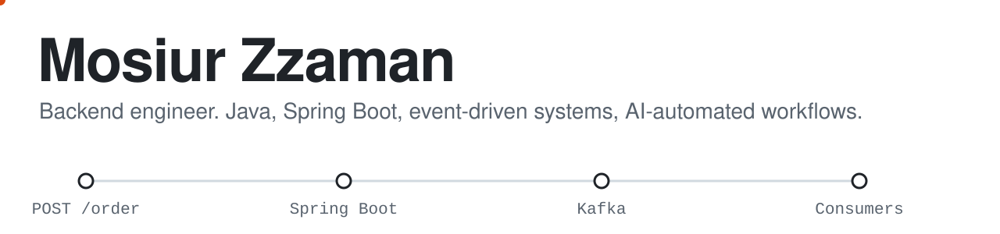

<picture>
  <source media="(prefers-color-scheme: dark)" srcset="assets/header-dark.svg">
  
</picture>

I'm a backend developer at [Rokomari.com](https://www.rokomari.com), building Java and Spring Boot systems for a large-scale e-commerce platform. Most of my work is the part customers never see: stock that doesn't oversell, events that don't get lost, and reports that finish before anyone gives up waiting.

**2+ years in production** · **3,500+ algorithm problems solved** · **ICPC Asia Dhaka Regional, 2021 and 2022**

### How I work

I own features from requirement to production. I break the requirement down line by line, check its business impact, and decide whether to ship it all at once or in phases. Then I build it, test it, get sign-off from the people who will use it, release it, and watch it in production with a rollback ready.

### Problems I solve

| The problem | How I solve it |
|---|---|
| Concurrent orders on limited stock | Inventory reservation with locking, so nothing oversells |
| Tracking activity as it happens | Event pipelines with Kafka and RabbitMQ |
| Messy, duplicated data | Normalized, schema-driven data models |
| Slow pages and reports | Redis caching and SQL tuning on million-row tables |
| Access handled by hand | Self-service role-based access control |
| Shipping safely | Testing, stakeholder sign-off, production monitoring, rollback plans |

### Projects you can read

- **[Real-Time Score Broadcaster](https://github.com/Mosiur99/Real_Time_Score_Broadcaster)**: pushes live scores to every browser across multiple app servers, using RabbitMQ fanout and WebSocket/STOMP. Scores are stored as an append-only event log.
- **[MicroURL](https://github.com/Mosiur99/URL_Shortener)**: URL shortener with click analytics on Redis, SHA-256 deduplication, and integration tests with Testcontainers. [Live demo](https://url-shortener-jp2d.onrender.com)
- **[SmartTour](https://github.com/Mosiur99/Smart_Tour)**: trip planner for all 64 districts of Bangladesh, with a budget calculator and PDF export. [Live demo](https://smart-tour-700j.onrender.com)

### What I work with

**Main:** Java, Spring Boot, Hibernate, MySQL, PostgreSQL, Redis, Kafka, RabbitMQ  
**Also:** MongoDB, Elasticsearch, Docker, JUnit 5, Testcontainers, Amazon S3  
**AI-assisted development:** Claude Code (custom skills, agentic workflows), Cursor, ChatGPT

### Competitive programming

ICPC Asia Dhaka Regional contestant in 2021 and 2022, two 1st places at university contests in 2022, and problem setter for NSTU contests.

[LinkedIn](https://www.linkedin.com/in/md-mosiur-zzaman-4008951b1/) · [Codeforces](https://codeforces.com/profile/mosiur_zaman) · [LeetCode](https://leetcode.com/mosiur) · mosiurzzaman99@gmail.com
